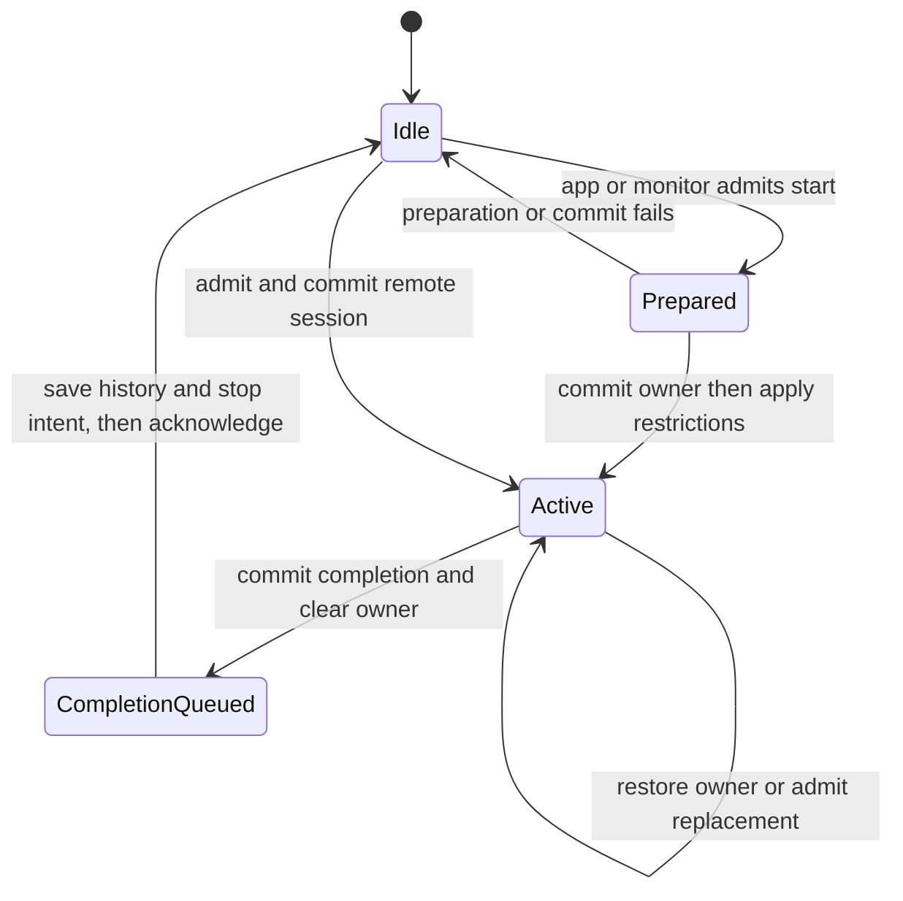

# Session lifecycle

The [V2 conditions rulebook](superpowers/specs/2026-10-02-508-v2-conditions-rulebook.md) defines intended behaviour. This page describes what the current implementation does. Only recorded product rulings establish intent.

## On one device

The app and DeviceActivity monitor share **one active slot across all profiles** in app-group storage. A profile ID identifies the configuration, a session UUID identifies one run, and a schedule occurrence identifies the event that can start it. Two devices can assign different UUIDs to the same occurrence.

| Transition | What the app or monitor checks and writes |
|---|---|
| Start | Manual, NFC, QR, link, Shortcut and schedule starts require an admitted origin and a usable stop. When a countdown applies, register it before publishing. The app saves the new row in SwiftData first. The monitor can start from the shared profile snapshot while the app is asleep. Both recheck the expected slot owner before committing. After unlocking, the process that committed the transition applies the current owner’s restrictions and rechecks the slot and grant. |
| Scheduled start | The monitor checks the occurrence against registration time, schedule edits, weekday and the profile’s last stopped timestamp. A stop recurrence between the start occurrence and callback delivery suppresses that start. Foreground refresh does not replay missed starts. |
| Switch | A confirmed tag switch or eligible scheduled takeover can replace the current owner. A local switch queues the outgoing completion when it commits the new owner. A refused switch leaves the original session running. |
| Grant | A break or One More Minute temporarily lifts shielding. After a grant change is committed, enforcement derives from the checked owner and grant. If either changes while applying restrictions, the process re-reads state and repairs the effect. The session clock keeps running. |
| Stop | An admitted manual, tag or Shortcut stop, authorized Emergency Unblock, matching remote stop, due countdown or independent stop recurrence can end the session. A countdown checks the instance and deadline. A scheduled stop checks the profile, instance and occurrence regardless of start method. The artificial end of a V2 start interval does nothing. |
| Complete and restore | A stop records completion and clears the slot before applying restrictions for the current state. Ending a schedule-originated session advances `scheduleLastStoppedAt`. The app saves completed history, records the matching cache completion and queues an exact stop when sync is enabled before acknowledging the snapshot. On foreground and before remote receipt or control selection, it restores the live shared owner by identity, including when a stop callback is late. A readable idle slot ends unowned open V2 rows and clears their pending starts. An unreadable slot defers repair. A V1 survivor retains its legacy lifecycle. |

Profile deletion and a synced-data wipe can clear ownership. Reset Blocking State checks for an active session before clearing stranded enforcement. A still-active V1 session follows its version-gated strategy until it ends. See [shared slot transitions](../Packages/FoqosShared/Sources/FoqosShared/SharedData.swift), [schedule callbacks](../Packages/FoqosShared/Sources/FoqosShared/Timers/ScheduleTimerActivity.swift) and [StrategyManager](../Foqos/Utils/StrategyManager.swift).

## Across devices

DeviceSync uses the owning iCloud account’s private zone. Each profile has one cloud session record and each receiving device caches its latest accepted copy. **Remote-only** means the cache shows an active session while this device has no local session for it, for example because the profile needs a local app selection.

- **Publish or join.** A local start may enforce while cloud confirmation is pending. The app drains older exact-instance stops and rechecks the candidate’s ownership and eligibility at delivery time and after cloud reads. It can retire a stale server winner by the expected identity and retry a still-valid candidate. A valid mirror adopts server identity and timing without registering another countdown. A restored owner remains locally controllable after its accepted stop deadline and cannot publish a historical start.
- **Receive.** The app refreshes the shared owner and processes completions before applying a cloud receipt. It checks identity, server modification date and sequence, and rejects a transition when local history, a matching pending stop, the accepted countdown, or an independent stop occurrence proves the run ended. Schedule-originated starts also check their originating occurrence against the latest stopped timestamp. An eligible remote-only record stays available even if local app selection prevents adoption. For eligible competing profiles the later start wins, with profile UUID as the tie-breaker. An inactive record selects its target against the refreshed local owner.
- **Propagate a stop.** A monitor or app completion remains replayable until history and any required exact stop intent have been saved. Legacy identity can be matched by start time within its scope. A missing, inactive or replaced target resolves an exact stop without ending a different instance. The outbox retains unresolved requests with the recorded completion time. Profile sync and snapshot publication retain the newest valid stopped stamp and ignore timestamps later than the receiver’s time.
- **Correlate transitions.** Successful start, stop and adoption log a normalized 12-digit hexadecimal prefix derived from the ephemeral session UUID. A changed-identity adoption logs both prefixes through the common app and monitor log facade.

See [SessionSyncService](../Foqos/CloudKit/SessionSyncService.swift), [SyncApplyService](../Foqos/CloudKit/SyncEngine/SyncApplyService.swift) and [SessionStopOutbox](../Foqos/CloudKit/SessionStopOutbox.swift).

## Defect status

The rows under verification name the regression coverage for the implementation. Simulator and device evidence are tracked separately.

| Observed defect | Disposition |
|---|---|
| An ended scheduled occurrence can restart after a remote delivery. | Under verification. Delivery-time admission checks the independent stop schedule, accepted countdown, completion history and occurrence stamp. Coverage in `SessionRecoveryTests` and `SessionTimerCASTests`. [#570](https://github.com/mnbf9rca/family-foqos/issues/570) |
| A monitor completion and stale active delivery can race, and a profile apply can erase the last stop. | Under verification. Exact completion is applied to history and cache before acknowledgement, and stamp merging retains a concurrent monitor stop. Coverage in `SessionRecoveryTests`, `SharedDataLockTests` and `SyncApplyServiceTests`. [#570](https://github.com/mnbf9rca/family-foqos/issues/570) |
| Failed history or outbox writes can leave stores disagreeing. | Under verification. The completed snapshot remains available for replay until both writes are durable. Coverage in `SessionRecoveryTests`. [#570](https://github.com/mnbf9rca/family-foqos/issues/570) |
| An in-memory session can outlive the shared owner after a monitor completion. | Open pending foreground UI verification. Hosted regressions cover refresh before remote inactive apply and control selection. [#570](https://github.com/mnbf9rca/family-foqos/issues/570) |
| ManagedSettings ran while the app held the file lock during adoption. | Under verification. Both adoption paths apply restrictions after releasing the lock, then check whether the owner or grant changed. Separate-descriptor and interleaving coverage is in `RestrictionApplyCurrentStateTests`. [#573](https://github.com/mnbf9rca/family-foqos/issues/573) |
| A kill during adoption can leave an orphaned active row that later restarts. | Under verification. Relaunch rebuilds the row for the committed owner and closes the displaced row, or restores idle if the slot was completed. Coverage in `SessionRecoveryTests` and `SessionTimerEndTests`. [#573](https://github.com/mnbf9rca/family-foqos/issues/573) |
| A delayed cloud session-record deletion can end a replacement. | Open. Deletion still selects by profile ID. [#570](https://github.com/mnbf9rca/family-foqos/issues/570) |
| A suspension kill occurred during November 13 sync bookkeeping. | Open. That stack used separate bookkeeping lock paths. The shorter session transitions address the adoption stack. [#573](https://github.com/mnbf9rca/family-foqos/issues/573) |
