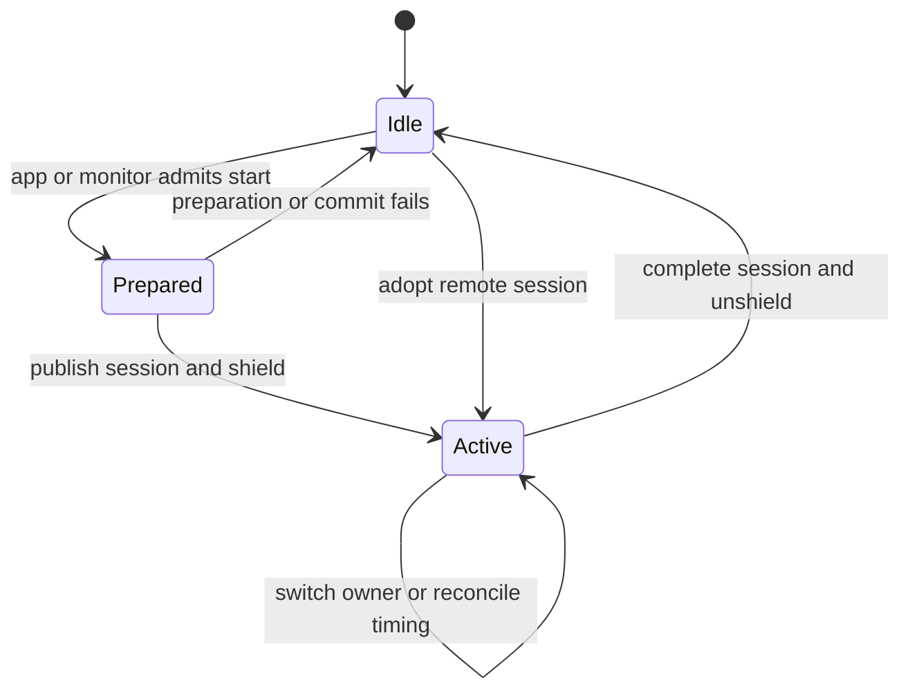

# Session lifecycle

The [V2 conditions rulebook](superpowers/specs/2026-10-02-508-v2-conditions-rulebook.md) defines intended behaviour. This page describes what the current implementation does. Only recorded product rulings establish intent.

## On one device

The app and DeviceActivity monitor share **one active slot across all profiles** in app-group storage. A profile ID identifies the configuration, a session UUID identifies one run, and a schedule occurrence identifies the event that can start it. Two devices can assign different UUIDs to the same occurrence.

| Transition | What the app or monitor checks and writes |
|---|---|
| Start | Manual, NFC, QR, link, Shortcut and schedule starts require an admitted origin and a usable stop. When a countdown applies, register it before publishing. The app saves the new row in SwiftData first. The monitor can start from the shared profile snapshot while the app is asleep. Both recheck the expected slot owner before committing. |
| Scheduled start | The monitor checks the occurrence against registration time, schedule edits, weekday and the profile’s last stopped timestamp. A stop recurrence between the start occurrence and callback delivery suppresses that start. Foreground refresh does not replay missed starts. |
| Switch | A confirmed tag switch or eligible scheduled takeover can replace the current owner. A local switch queues the outgoing completion when it commits the new owner. A refused switch leaves the original session running. |
| Grant | A break or One More Minute temporarily lifts shielding. Closing or expiring the grant restores restrictions if the session still owns the slot. The session clock keeps running. |
| Stop | An admitted manual, tag or Shortcut stop, authorized Emergency Unblock, matching remote stop, due countdown or independent stop recurrence can end the session. A countdown checks the instance and deadline. A scheduled stop checks the profile, instance and occurrence regardless of start method. The artificial end of a V2 start interval does nothing. |
| Complete and restore | Completion queues an ended snapshot, clears the slot and lifts restrictions. Ending a schedule-originated session through this path stamps `scheduleLastStoppedAt`. On active-session lookup the app imports completed snapshots, then the active snapshot, then reads the newest SwiftData row with `endTime == nil`. Until the next lookup, the app can still display the session it last loaded, even after the monitor has unshielded. |

Profile deletion and a synced-data wipe can clear ownership. Reset Blocking State checks for an active session before clearing stranded enforcement. A still-active V1 session follows its version-gated strategy until it ends. See [shared slot transitions](../Packages/FoqosShared/Sources/FoqosShared/SharedData.swift), [schedule callbacks](../Packages/FoqosShared/Sources/FoqosShared/Timers/ScheduleTimerActivity.swift) and [StrategyManager](../Foqos/Utils/StrategyManager.swift).

## Across devices

DeviceSync uses the owning iCloud account’s private zone. Each profile has one cloud session record and each receiving device caches its latest accepted copy. **Remote-only** means the cache shows an active session while this device has no local session for it, for example because the profile needs a local app selection.

- **Publish or join.** With sync enabled, a local start can already be enforcing while cloud confirmation is pending. The app processes older exact-instance stops for that profile, then conditionally saves its start or joins the existing active record. A mirror takes the server’s identity and timing when available without registering another countdown.
- **Receive.** The app checks incoming records against cached identity, server modification date and sequence. An accepted active record can fill an idle slot. For competing profiles the later start wins, with profile UUID as the tie-breaker. An update for the same profile goes through timing and identity reconciliation. An inactive record can stop the matching local session.
- **Propagate a stop.** The monitor queues its completion locally. The app imports it and, with sync enabled, attempts a cloud stop for the expected instance. Older records can use start time for matching. The stop outbox retains unresolved requests for retry. A missing, inactive or replaced target can resolve an exact stop while another instance remains active. A remote-only stop can also queue on a transient service failure.

See [SessionSyncService](../Foqos/CloudKit/SessionSyncService.swift), [SyncApplyService](../Foqos/CloudKit/SyncEngine/SyncApplyService.swift) and [SessionStopOutbox](../Foqos/CloudKit/SessionStopOutbox.swift).

## Known defects

- **A stopped occurrence can restart.** Unlike the scheduled-start callback, `StrategyManager.startRemoteSession` and `SharedData.adoptAuthoritativeSession` skip both `scheduleLastStoppedAt` and the intervening-stop check. Cloud reads do not expire a retained active record, so adoption can reapply restrictions after the local stop. The rulebook gives the stop precedence and also permits reconciliation of an existing authoritative session. [Independent schedule recurrences](superpowers/specs/2026-10-02-508-v2-conditions-rulebook.md#independent-schedule-recurrences-515517) · [#570](https://github.com/mnbf9rca/family-foqos/issues/570)
- **A monitor stop can race an active record.** Importing the completion does not immediately mark the remote cache inactive. An active record can pass the receipt check and be adopted even with ended history for that UUID. [#570](https://github.com/mnbf9rca/family-foqos/issues/570)
- **A profile update can erase the last stop.** When updating an existing profile, `SyncApplyService` copies the incoming stopped timestamp, even if older or absent, and republishes the snapshot. [#570](https://github.com/mnbf9rca/family-foqos/issues/570)
- **A failed write can leave stores disagreeing.** Completion import clears the shared queue before history and the stop outbox are durable. Remote adoption shields before saving its session row, and app stop cleanup proceeds after a failed history save. [#570](https://github.com/mnbf9rca/family-foqos/issues/570)
- **A delayed cloud deletion can end a replacement.** Session-record deletion checks only the profile ID, so it can stop a newer instance of that profile. [#570](https://github.com/mnbf9rca/family-foqos/issues/570)

Update or remove a defect entry in the PR that fixes it.
